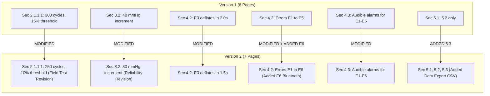
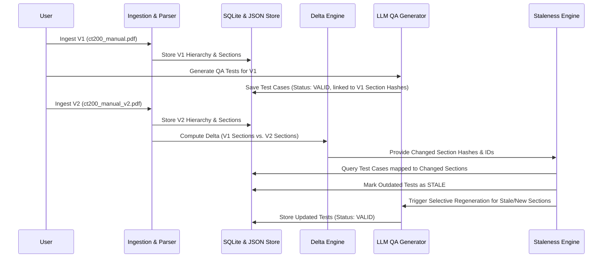

# System Architecture and Technical Approach
## Tri9T-CT200-Document-Intelligence

Author: AI Engineering Internship Candidate  
Project: Tri9T-CT200-Document-Intelligence  
Target Documents: CardioTrack CT-200 Technical & User Manual (Version 1 & Version 2)

---

## 1. Executive Summary

The objective of the **Tri9T-CT200-Document-Intelligence** system is to provide an end-to-end intelligent document platform capable of:
1. Ingesting and faithfully parsing complex technical manuals containing non-linear section numbering, hierarchical gaps, multi-line tables, and cross-page text splits.
2. Building and maintaining a validated, canonical document hierarchy tree.
3. Managing document versions (`ct200_manual.pdf` vs. `ct200_manual_v2.pdf`) and calculating granular section-level deltas.
4. Synthesizing robust, traceable QA test cases using an LLM based on extracted specifications.
5. Detecting stale test cases when document updates invalidate previously generated assertions.

This document outlines the detailed empirical findings from our deep inspection of the source PDFs, the architectural rationale for parsing, storage, and version diffing, and the concrete implementation strategy for subsequent milestones.

---

## 2. Empirical Document Inspection & Evidence Analysis

A programmatic inspection of `data/ct200_manual.pdf` (Version 1) and `data/ct200_manual_v2.pdf` (Version 2) was performed using PyMuPDF (`pymupdf`).

### 2.1 Physical File Metrics

| Metric | Version 1 (`ct200_manual.pdf`) | Version 2 (`ct200_manual_v2.pdf`) | Delta / Notes |
|---|---|---|---|
| **File Size** | 443,032 bytes | 447,477 bytes | +4,445 bytes |
| **Total Pages** | 6 pages | 7 pages | +1 page (content expansion) |
| **Page Dimensions** | 420.0 pt × 595.0 pt (A5 standard) | 420.0 pt × 595.0 pt (A5 standard) | Identical layout geometry |
| **Raster Images** | 0 embedded images | 0 embedded images | Zero bitmap images |
| **Vector Drawings** | Horizontal divider rules | Horizontal divider rules | Clean vector lines |
| **Text Layer** | Complete, digital vector text | Complete, digital vector text | 100% extractable text layer |

### 2.2 Typography and Style Hierarchy

Extraction of font spans across both documents revealed a consistent, deterministic typographic scale:

| Level / Role | Font Family | Size (pt) | Flags | Visual Weight | Example Content |
|---|---|---|---|---|---|
| **Document Title** | NimbusSans-Bold | 22.0 | 20 | Bold | `CardioTrack CT-200 Home Blood Pressure Monitor — Technical & User Manual` |
| **Major Heading (H1)** | NimbusSans-Bold | 16.5 | 20 | Bold | `1. Device Overview`, `2. Physical and Electrical Specifications`, `3. Device Operation` |
| **Subheading (H2)** | NimbusSans-Bold | 12.9 | 20 | Bold | `1.1 Intended Use`, `1.2 Indications and Contraindications`, `2.1 General Specifications` |
| **Sub-subheading (H3/H4)** | NimbusSans-Bold | 11.0 | 20 | Bold | `2.1.1.1 Battery Life Under Typical Use` |
| **Table Headers** | NimbusSans-Bold | 11.0 | 20 | Bold | `Parameter`, `Value`, `Code`, `Meaning`, `Device Behavior` |
| **Body Text / Lists** | NimbusSans-Regular | 11.0 | 4 | Regular | Standard descriptive paragraphs, ordered list items 1–5 |
| **Special Glyph Font** | NotoSerif-Regular | 11.0 | 4 | Regular | Non-breaking hyphens (`‑`), specific punctuation marks |

### 2.3 Parsing Engine Selection: Vector Layout vs. OCR

- **Finding**: Both PDF files are born-digital vector documents. The glyphs, font dictionaries, and text coordinates are preserved natively within the PDF streams. Zero scanned raster images exist.
- **Decision**: PyMuPDF's direct text-block, span-dictionary, and vector table layout extraction (`page.get_text("dict")` and `page.find_tables()`) is chosen as the primary parser. OCR (e.g., Tesseract) would introduce unnecessary latency, optical character recognition errors, and non-determinism. OCR will only be kept as an optional fallback plug-in if arbitrary scanned PDF uploads are introduced in the future.

---

## 3. Structural Irregularities & Edge Cases

The source documents contain several specific structural irregularities that require dedicated algorithmic handling.

### 3.1 Non-Sequential Section Numbering (Section 3.4 preceding Section 3.3)
- **Observation**: On Page 3 of both Version 1 and Version 2:
  - Section `3.2 Cuff Inflation Sequence` is followed immediately by:
    - `3.4 Auto Shutoff` (Lines 131–135 in V1; Lines 427–431 in V2)
  - This is followed by:
    - `3.3 Result Display and Classification` (Lines 137–150 in V1; Lines 433–446 in V2)
- **Impact**: Naive sequential parsers that validate `N+1` or assume monotonic numbering will misclassify Section 3.4 or drop Section 3.3.
- **Architectural Solution**: The parser distinguishes between:
  1. **Reading Flow Order** (`reading_index`): Preserves the physical top-to-bottom layout of the printed manual.
  2. **Canonical Hierarchy Tree**: Places both `3.3` and `3.4` as sibling child nodes under parent `3. Device Operation`. The section nodes will retain their explicit section numbers as canonical identifiers while indexing their sequential document appearance.

### 3.2 Hierarchy Gap (Section 2.1.1.1 with no Section 2.1.1 parent)
- **Observation**: On Page 2 of both manuals:
  - Section `2.1 General Specifications` contains the specifications table.
  - Immediately following the table is subsection `2.1.1.1 Battery Life Under Typical Use`.
  - There is no heading for `2.1.1` in the document.
- **Impact**: A strict recursive descent parser expecting `level_k` to have an immediate `level_{k-1}` parent node would throw an unhandled parent reference exception.
- **Architectural Solution**: The parser implements a **Flexible Ancestor Resolution** strategy:
  - If a section with depth 4 (`2.1.1.1`) is encountered under depth 2 (`2.1`), the hierarchy builder attaches `2.1.1.1` directly to `2.1` while annotating a synthetic parent placeholder `2.1.1 [Implied Parent]` or recording an `implicit_parent` relationship. This preserves tree validity without distorting source document fidelity.

### 3.3 Structured Tabular Data Retention
The documents contain two critical tables that convey strict operational criteria:
1. **Section 2.1 Table (General Specifications)**:
   - 8 rows, 2 columns (`Parameter` | `Value`).
   - Pairs exact technical parameters (e.g., `Accuracy (pressure): ±3 mmHg`, `Power source: 4x AA batteries or 6V DC adapter`).
2. **Section 4.2 Table (Error Codes)**:
   - 3 columns (`Code` | `Meaning` | `Device Behavior`).
   - Contains multi-line descriptions and behaviors (e.g., `E2`: "Motion artifact detected during measurement", Behavior: "Aborts measurement, displays E2, prompts retry").
   - Version 1 has 5 rows (`E1` to `E5`).
   - Version 2 has 6 rows (`E1` to `E6`).
- **Impact**: Converting tables into raw unstructured text loses column relationships, making automated test case generation unreliable.
- **Architectural Solution**: Tables are extracted as structured objects (`List[Dict[str, str]]` and markdown-compatible grid format) and attached directly to their host sections as `content_type="table"`.

### 3.4 Cross-Page Content Splitting
Content frequently breaks across page boundaries mid-paragraph and mid-sentence:
1. **Section 3.1 (V1)**: Starts at bottom of Page 2 ("*Press and hold the power button for one second to power on the device.*") and continues onto Page 3 ("*Use the profile button to select User 1 or User 2...*").
2. **Section 4.3 (V2)**: Starts on Page 4 ("*...except for E3*") and finishes on Page 5 ("*(overpressure), which cannot be silenced for safety reasons.*").
3. **Section 6.1 (V2)**: Starts on Page 5 ("*...Do not submerge the device or cuff, and do not*") and completes on Page 6 ("*use alcohol, solvents, or abrasive cleaners on the display.*").
4. **Section 8.1 (V2)**: Starts on Page 6 ("*...non‑invasive blood pressure monitors and has been*") and completes on Page 7 ("*validated against relevant clinical accuracy standards for oscillometric devices.*").
- **Architectural Solution**: The page segmenter maintains an active section context accumulator across page breaks. If a new page begins with an unpunctuated or uncapitalized body span without a preceding heading, it is stitched onto the trailing paragraph block of the preceding section.

---

## 4. Comprehensive Version 1 vs. Version 2 Delta Analysis

Our differential analysis identified the following exact specification changes between V1 and V2:

### Granular Delta Matrix

| Section ID & Name | Version 1 Content | Version 2 Content | Delta Type | Impact on Test Cases |
|---|---|---|---|---|
| **2.1.1.1 Battery Life Under Typical Use** | `300 measurement cycles`, `15% remaining capacity` | `250 measurement cycles`, `10% remaining capacity`, added field testing justification | **MODIFIED** | Battery cycle count test cases and low-battery alert threshold test cases become **STALE**. |
| **3.2 Cuff Inflation Sequence** | `inflates in 40 mmHg increments` | `inflates in 30 mmHg increments`, added rationale regarding pulse detection reliability | **MODIFIED** | Cuff step inflation test cases become **STALE**. |
| **4.2 Error Codes (E3 Overpressure)** | `Auto-deflates within 2 seconds` | `Auto-deflates within 1.5 seconds` | **MODIFIED** | Safety timing assertion test cases become **STALE**. |
| **4.2 Error Codes (E6 Addition)** | *Not present* | `E6: Bluetooth sync failure`, `Displays E6 on next sync attempt; does not affect measurement` | **ADDED** | New test cases required for `E6` display and non-disruption of measurement. |
| **4.3 Alarm Thresholds** | `audible alarms are limited to the E1–E5 error conditions` | `audible alarms are limited to the E1–E6 error conditions` | **MODIFIED** | Alarm configuration test cases become **STALE**. |
| **5.3 Data Export** | *Not present* | Introduces CSV export support starting firmware 1.4 with timestamp, profile, systolic, diastolic, pulse, classification; requires successful sync | **ADDED** | New functional test suite required for CSV export conditions. |

---

## 5. Storage Architecture Justification

The requirements mandate a hybrid persistent store:
1. **Relational Database (SQLite via SQLAlchemy)**
2. **Document Store (JSON Document Store in `generated/` / MongoDB)**

### 5.1 Why a JSON Document Store is Well-Justified for Hierarchy & Outputs
- **Arbitrary Depth & Tree Traversal**: The parsed document hierarchy is an Abstract Syntax Tree (AST) where sections have children, nested tables, lists, and metadata. In relational databases, storing arbitrary hierarchical trees requires nested set models or recursive CTEs with complex joins. A JSON document store allows natural serialization, retrieval, and validation of full document trees in $O(1)$ read time.
- **LLM Output Serialization**: LLM-generated test cases contain varied structured payloads (preconditions, steps, expected results, assertions, tags). Storing them as structured JSON documents preserves schema flexibility without requiring constant relational database migration.
- **File System Portability**: Storing versioned JSON artifacts in `generated/` ensures self-contained reproducibility without forcing external database setup, while our design includes a modular repository pattern that allows instant swapping to MongoDB when `DOCUMENT_STORE_TYPE=mongodb`.

### 5.2 Role of SQLite / SQLAlchemy
SQLite handles relational integrity and index lookups:
- `documents`: Document ID, filename, upload timestamp, active version.
- `document_versions`: Version ID, document ID, version number (`v1`, `v2`), page count, content hash.
- `sections`: Section ID, version ID, section number, title, canonical depth, content hash.
- `test_cases`: Test Case ID, section ID, title, test type, status (`VALID`, `STALE`, `DEPRECATED`), generation timestamp.

---

## 6. Document Versioning & Staleness Engine Design

### Staleness Criteria
A test case $T$ is flagged as **STALE** if:
$$\text{hash}(S_{v1}) \neq \text{hash}(S_{v2})$$
where $S$ is the referenced document section. If a section is removed in a future revision, associated test cases are transitioned to **DEPRECATED**.

---

## 7. Phased Implementation Roadmap

- **Step 1 (Current Step)**: Environment verification, PDF deep inspection, structural irregularity documentation, repository scaffolding, git initialization, and architecture blueprint.
- **Step 2**: Robust PDF parser implementation using PyMuPDF (layout analysis, table extraction, section tree reconstruction, cross-page stitching).
- **Step 3**: Data models, SQLite ORM schemas, and JSON document store integration.
- **Step 4**: Versioning and diff engine (AST-based semantic and hash comparison).
- **Step 5**: LLM QA test case generation service with prompt engineering and Pydantic validation.
- **Step 6**: Automated staleness detection engine and dependency graph.
- **Step 7**: FastAPI endpoints, integration test suite (`pytest`), and complete verification.
